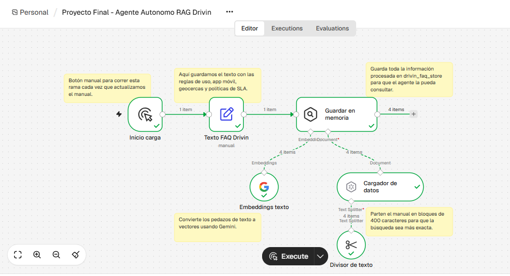
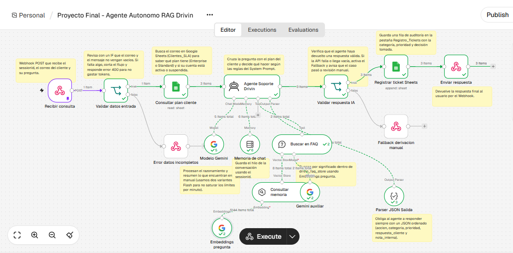
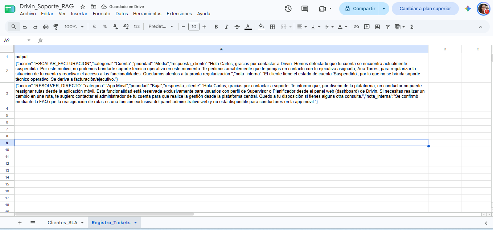

# Agente de Soporte y Triaje Nivel 1 para Drivin (n8n + RAG)

Este proyecto automatiza el triaje y la primera respuesta de soporte técnico para **Drivin** (software de gestión logística y transporte). La idea nació porque en operaciones de transporte los conductores y planificadores necesitan respuestas rápidas en ruta, y gran parte de los tickets diarios de Nivel 1 son consultas repetitivas sobre el uso de la app o reglas de cuenta que consumen demasiado tiempo del equipo.

---

## 1. Caso de Negocio y ROI Estimado

### El problema manual
Hoy, cuando entra un ticket de soporte, un analista tiene que abrir el CRM o planilla de clientes para revisar qué plan tiene la empresa (`Enterprise` o `Standard`) y si su cuenta está al día o suspendida. Después, busca en la documentación interna cómo responder la duda (sobre geocercas, pruebas de entrega o permisos de ruta) o decide si escalar el caso a Nivel 2, y finalmente anota el ticket en una planilla de seguimiento.

### Cálculo de tiempos y costos
* **Volumen estimado:** ~40 consultas operativas al día (800 tickets al mes en 20 días hábiles).
* **Tiempo manual promedio:** 8 minutos por ticket (revisar plan del cliente, buscar en manuales, responder y registrar).
* **Horas invertidas al mes:** $800 \text{ tickets} \times 8 \text{ min} = 6.400 \text{ minutos} \approx \mathbf{106 \text{ horas/mes}}$.
* **Costo actual:** Tomando una referencia de **$10 USD/hora** para soporte técnico Nivel 1, mantener este proceso manual cuesta unos **$1.060 USD/mes**.

### Impacto con la automatización
* **Ahorro real:** El agente resuelve de forma automática cerca del **70% de las dudas frecuentes** (560 tickets/mes) en menos de 6 segundos, y deja pre-clasificado con prioridad el 30% restante que sí requiere un humano (ahorrando unos 5 minutos de diagnóstico por caso). Esto libera aproximadamente **88 horas al mes** (**$880 USD/mes** de ahorro).
* **Costo del sistema:** Entre el entorno de n8n (~$20 USD/mes) y el consumo de API de Gemini Flash (~$2 USD/mes para ese volumen), el costo operativo ronda los **$22 USD/mes**.
* **ROI mensual:**
  $$\text{ROI} = \frac{\$880 - \$22}{\$22} \times 100 \approx \mathbf{3.900\%}$$

### Escalabilidad y límites del ROI
Automatizar escala mucho mejor que sumar analistas porque el flujo atiende consultas 24/7 sin demoras en horarios pico de reparto. Sin embargo, **dejaría de tener sentido** si el volumen de soporte bajara a menos de 40 tickets mensuales (el tiempo de mantener actualizado el manual pesaría más que el ahorro) o si la plataforma cambiara sus reglas cada semana sin actualizar la base documental del Vector Store.

---

## 2. Cómo funciona el Workflow

El flujo en n8n está separado en dos ramas principales con notas explicativas (*Sticky Notes*) en cada bloque:

1. **Rama de carga (Ingesta RAG):** Toma el manual operativo de Drivin, lo divide en fragmentos con `Recursive Character Text Splitter` (chunks de 400 caracteres con solapamiento de 50), genera los vectores con `Gemini Embeddings` y los guarda en memoria bajo la clave `drivin_faq_store`. Esta rama se ejecuta cada vez que se actualiza la documentación.
2. **Rama de atención y decisión:**
   * **Entrada 1 (`Recibir consulta`):** Webhook `POST` que recibe `sessionId`, `cliente_email` y `mensaje`.
   * **Validación de entrada (`Validar datos entrada`):** Nodo `IF` que frena peticiones incompletas antes de gastar tokens.
   * **Entrada 2 (`Consultar plan cliente`):** Busca el email del cliente en Google Sheets (`Clientes_SLA`) para traer su `empresa`, `plan`, `estado_cuenta` y `ejecutivo`.
   * **Agente con criterio (`Agente Soporte Drivin`):** Cruza los datos de Sheets con lo que encuentra en la herramienta `Buscar en FAQ` y usa `Parser JSON Salida` para devolver una decisión estructurada (`accion`, `categoria`, `prioridad`, `respuesta_cliente` y `nota_interna`).
   * **Salidas reales:** Si la respuesta es válida, guarda el registro en la pestaña `Registro_Tickets` de Google Sheets y responde al cliente vía Webhook.

---

## 3. Decisiones Técnicas

### ¿Por qué un AI Agent con RAG y no un nodo de IA simple?
* **Por qué RAG:** Incluir todo el manual operativo dentro del prompt encarece cada consulta y hace que el modelo pierda precisión. Con RAG solo se recuperan los párrafos que realmente tienen relación con lo que pregunta el usuario.
* **Por qué un AI Agent:** Un nodo de IA simple solo redacta texto. Acá el sistema necesita **tomar decisiones según reglas de negocio**: primero consulta la herramienta de documentación, luego evalúa el estado de la cuenta que viene de Google Sheets (por ejemplo, si el cliente está `Suspendido`, bloquea el soporte técnico y lo deriva a facturación; si es `Enterprise` con fallo de API, le da prioridad `Alta`) y finalmente entrega un JSON limpio para automatizar el registro.

### Elección del modelo: Nube (Google Gemini) vs. Local (Ollama)
Elegí correr los modelos en la nube (**Google Gemini Flash**) en lugar de levantar **Ollama** en local por tres motivos prácticos:
1. **Costo y hardware:** Para 800 tickets al mes, la API en la nube sale prácticamente gratis o por un par de dólares, mientras que mantener una máquina con GPU encendida 24/7 para correr modelos locales capaces de manejar bien *Tool Calling* y *Structured Output* es mucho más costoso.
2. **Privacidad:** Los datos que viajan en este flujo son preguntas operativas sobre el uso del software y datos básicos de cuenta (empresa, plan y correo laboral), sin información financiera sensible ni contraseñas que exijan aislamiento local.
3. **Estabilidad en herramientas:** Durante las pruebas comprobé que separar la carga entre dos variantes Flash en la nube (`gemini-3.6-flash` para el agente y `gemini-3.6-flash-lite` para la herramienta RAG) y limitar las iteraciones a `2` evita saturar los límites por minuto (RPM) manteniendo respuestas rápidas y estructuradas.

---

## 4. Manejo de Errores y Casos Límite

Contemplé dos puntos donde el flujo puede fallar en la práctica:

1. **Peticiones vacías o incompletas (`Validar datos entrada`):** Si alguien llama al Webhook sin `mensaje` o sin `cliente_email`, el Vector Store fallaría intentando vectorizar texto vacío. Puse un nodo `IF` justo después del Webhook que corta el proceso y responde un `HTTP 400` avisando qué datos faltan, sin gastar llamadas a la API.
2. **Fallo del modelo o salida vacía (`Validar respuesta IA`):** Si la API de Gemini llega a dar *timeout*, error 429 o no devuelve el campo `respuesta_cliente`, un segundo nodo `IF` detecta que la salida está vacía y desvía el flujo hacia `Fallback derivacion manual`, avisando al usuario que su caso pasó a un especialista humano en lugar de dejarlo sin respuesta.

---

## 5. System Prompt del Agente

```text
Eres el Agente Autonomo de Triaje y Soporte Tecnico Nivel 1 de Drivin (plataforma SaaS de gestion de transporte y logistica).

TU OBJETIVO:
Analizar la consulta del usuario, cruzarla con los datos de su cuenta (Plan y Estado) y consultar obligatoriamente la herramienta 'buscar_faq_drivin' antes de tomar una decision operativa.

REGLAS DE DECISION Y ALCANCE:
1. Si el estado_cuenta es 'Suspendido': No des soporte tecnico operativo. Clasifica accion como 'ESCALAR_FACTURACION', prioridad 'Media' e informa amablemente que debe contactar a su ejecutivo asignado para regularizar su cuenta.
2. Si la consulta se resuelve con el manual operativo de Drivin (app movil, POD, geocercas, roles): Clasifica accion como 'RESOLVER_DIRECTO', prioridad 'Baja' y redacta la solucion clara paso a paso.
3. Si el cliente reporta una caida critica de API/ERP o un error tecnico no cubierto en el manual: Clasifica accion como 'ESCALAR_SOPORTE_N2'. Si su plan es 'Enterprise', asigna prioridad 'Alta'; si es 'Standard', asigna prioridad 'Media'.
4. Si el mensaje es ambiguo o no corresponde a Drivin: Clasifica accion como 'PEDIR_ACLARACION', prioridad 'Baja' y solicita los detalles faltantes sin inventar funciones.

TONO Y FORMATO:
- Profesional, empatico, directo y en espanol.
- Responde exclusivamente respetando el esquema JSON estructurado.
```

---

## 6. Capturas del Proyecto

### 1. Rama de Ingesta RAG (Carga del manual a memoria)


### 2. Flujo Principal (Entradas, Agente RAG, Control de Errores y Salidas)


### 3. Registro de Auditoría en Google Sheets


---

## 7. Checklist de Verificación

1. **Archivo `.json` exportado:** Incluido en la raíz como `workflow-agente-rag.json`.
2. **Dos fuentes de entrada:** Webhook `POST` (`Recibir consulta`) + lectura de base de clientes en Google Sheets (`Consultar plan cliente`).
3. **System Prompt completo:** Documentado en la sección 5 con reglas de negocio, manejo de ambigüedad y restricciones.
4. **ROI y elección de modelo:** Justificados en las secciones 1 y 3 con costos, límites y comparativa Nube vs. Local.
5. **Manejo de errores:** Implementado con dos nodos `IF` (`Validar datos entrada` y `Validar respuesta IA`) antes de ejecutar las salidas finales.
